# Six Weeks Ahead: Forecasting Sales for 1,115 Rossmann Stores

*How gradient boosting set the bar, why a two-layer LSTM fell short of it, and what we shipped*

**NextHikes IT Solutions | Machine Learning Engineering | November 2026**

> **The short version**
> - We forecast daily sales and customers for all 1,115 Rossmann stores, up to six weeks ahead, and shipped the forecasts as a web app: https://rossmann-forecast-nexthikes.streamlit.app/
> - On a holdout reserved until the final evaluation, the production model's error (RMSPE) is **0.1068**. The best simple rule scores 0.1468, so the model's error is 27% lower.
> - We built a two-layer LSTM properly: stationarity tests, autocorrelation, sliding windows, three seeds. It still lost to gradient boosting in every window (14.6% higher error). A decision rule we wrote before looking settled it.
> - Every forecast carries a 90% range. On the holdout it contained the actual value 88.4% of the time.

## The problem: a forecast you can audit

Rossmann's finance team wants each store's daily sales **six weeks ahead**, for staffing, stock and budgets. Store managers want the same forecast for their own store, with customers, in a form they can adjust. Today those forecasts come from experience and personal judgement. That can be wise, but it cannot be audited, compared across 1,115 stores, or re-run when the promotion plan changes.

We were given 1,017,209 store-days (January 2013 to July 2015), a file of store details (type, assortment, competition, a second promotion scheme), and a 48-day test window, 1 August to 17 September 2015, with the *planned* promotions, holidays and opening days but no sales and no customers. That last detail shapes everything that follows: a forecast may use the plan for the days ahead, and the history up to the cut-off, and nothing else.

## Part 1. Look before you model

The data had plot twists. **One hundred and eighty stores vanish for six months**, from 1 July to 31 December 2014, all missing exactly the same block. We did not fill the gap: invented sales would teach the model things that never happened, so the stores are flagged and no feature crosses the gap. Fifty-four open days have zero sales and are treated as suspected recording errors, so they are excluded from training. A store (622) is missing its `Open` flag for 11 test days, which we set by rule. And we resisted the textbook outlier rule: a global IQR filter would have deleted 30,769 promotion and peak days, exactly what the model must learn. The 986 genuinely unusual store-days are flagged and kept.

Then the findings.

**The calendar sets the rhythm.** December runs at 1.22 times a typical day (a day's sales divided by that store's typical sales on that weekday). The run-up to Christmas is about 1.5, then 24 December collapses to 0.71. The three days before Easter sell about 40% more, and almost every store closes on state holidays.

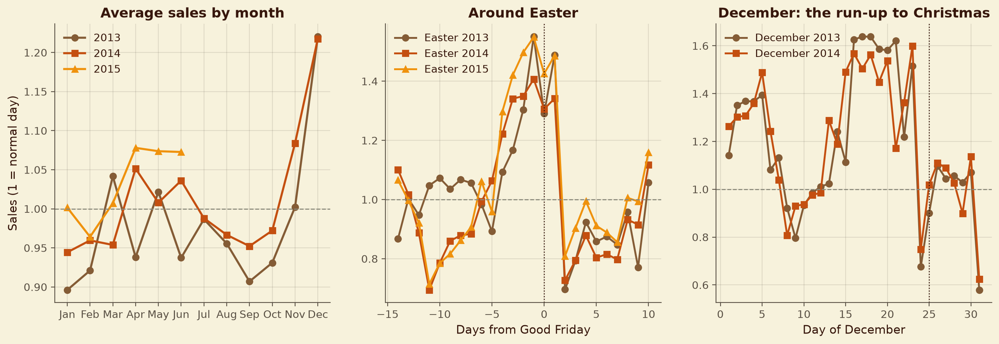

**Promotion days sell more in every store, but unevenly.** On ordinary weekdays, promotion days average 39% higher sales, 20% more customers and 16% more spend per customer: more shoppers *and* bigger baskets. Monday promotion days are 57% higher, Friday ones 22%. All 1,115 stores had higher average sales on promotion days (from 2% to 103%, median 39%), and the weakest responders are type b stores (15%) and stores with the extra assortment (12%). These are associations from one shared promotion calendar, not proof of cause.

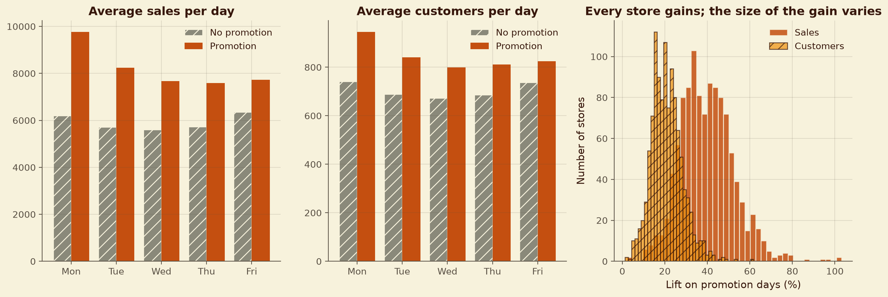

**Customers explain two thirds of sales.** The correlation between daily sales and customers is 0.83, but the test file contains no customers, so customers get their own forecasting model later on. Store type matters more than assortment: the 17 type b stores are traffic-driven, with about 2,000 customers a day and small baskets (5.1 per customer against 11.2 for type d), and only 33 stores ever trade on Sundays.

**Stores sold less after a competitor opened nearby.** For the 120 stores whose competitor opened during the data, sales were 7.1% lower on average over the next three months than those of similar stores (80% of them fell), and 13.9% lower for competitors within a kilometre. Chance alone would produce a change between -0.9% and +1.2%.

**The test window is a summer window.** School holidays cover 44% of its days, against 18% of all training days. That one number changed how we validated.

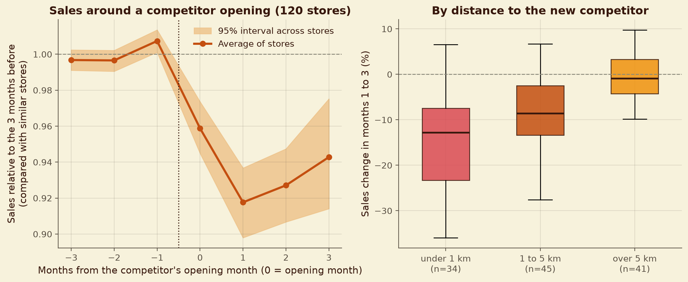
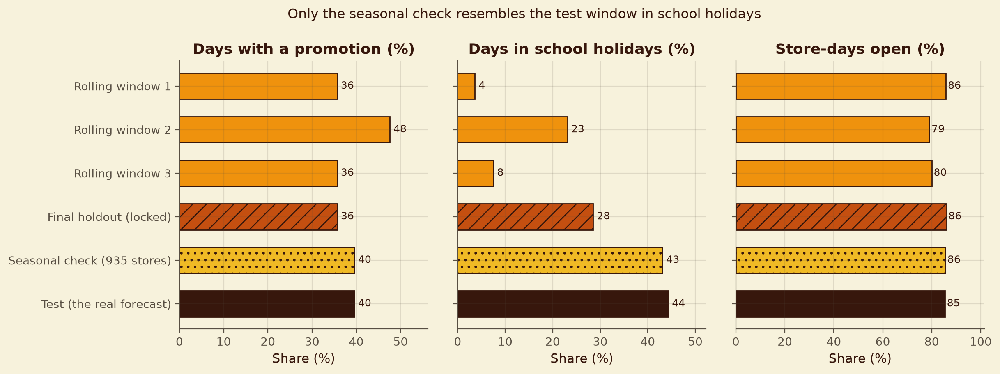

## Part 2. Rig the test so it can't lie

A forecast is only as trustworthy as the test it passed. Every forecast here is made the way the real one will be: from a **single cut-off**, with only the history before that day plus the planned calendar of the days ahead.

Three rolling 42-day windows (February to June 2015) choose between models. A **seasonal check**, the same calendar window one year earlier (1 August to 17 September 2014), is the only window that looks like the real test, with 43% school-holiday days, and it is not used for tuning, only as a consistency check on the choice. The last 42 days (20 June to 31 July 2015) are a **final holdout**, locked in code under a fingerprint and scored by the frozen configuration in the final run.

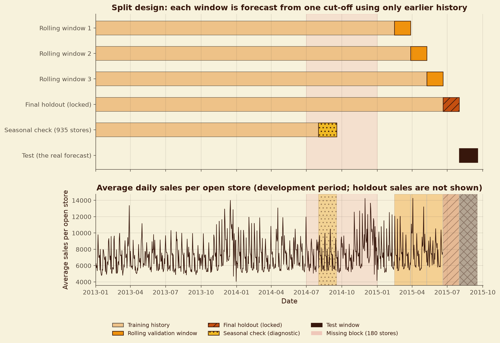

Leakage is a failed test, not a judgement call. A written feature-availability policy blocks customers and every sales value after the cut-off, and perturbation tests prove that scrambling future sales changes no input.

**The loss function.** Finance reads forecasts in percentages: a miss of 500 matters far more for a small store than for a large one. So the metric is RMSPE (root mean squared percentage error), and the models learn log(1 + sales), where an error is a relative error. We compared three objectives on identical data: plain squared error on raw sales scored 0.1409, the textbook 1/sales² weighting 0.2414 (days with tiny sales get huge weights and wreck the fit), and the log target **0.1344**, 4% better than raw and easy to explain.

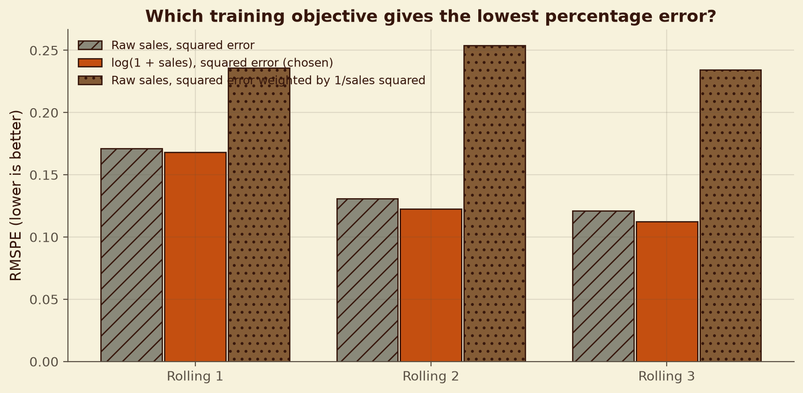

## Part 3. The model that set the bar

Training rows are simulated forecasts: 32 historical cut-off dates, each paired with every store and each of the next 48 days. Each row has **59 features** in three groups: the calendar and planned inputs (weekday, month position, distance to and from holidays, promotions this and last week), store details, and the store's own history up to the cut-off (recent and long-run averages, its average for each weekday, its promotion lift). Everything sits in one scikit-learn pipeline with a StandardScaler, so training, validation and the app run identical code.

Gradient boosting beat Random Forest, Ridge regression and the best simple rule (each store's average for that weekday and promotion status) in every window, and it was the only model to get close to the 0.13 target: 0.1301 at 150,000 training rows (a miss of 0.0001) and 0.1297 at 400,000 rows for the final candidate. Ridge never beat the simple rule: a linear model cannot capture holidays and their interactions.

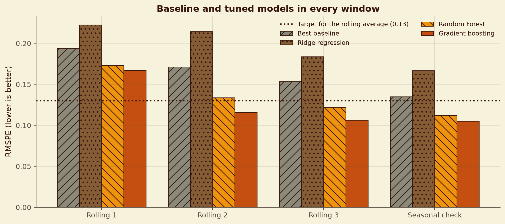

What does it rely on? Three importance measures agree: **the store's own average for that weekday** comes first by a distance, then the promotion flag, then the promotion week. The store's history carries 47% to 74% of the importance, promotions 12% to 24%, the calendar and holidays most of the rest, and competition less than 4% (only a few stores have a recent opening, even though those few matter a lot). It is the ordering a manager would give: what a store usually sells on a Tuesday sets the level, promotions move it, holidays shift single days.

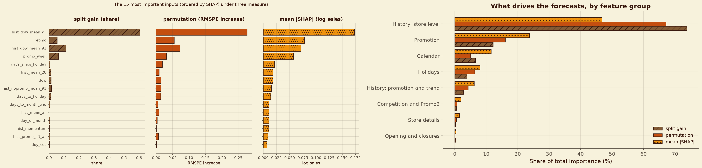

## Part 4. Deep learning: a two-layer LSTM

This is where we spent most of our effort, and where we learned the most. We followed the brief step by step, then went beyond it: from "predict the next sale" to a six-week forecast, and from one chain-level series to **one LSTM shared by all 1,115 stores**, judged against gradient boosting on exactly the same rows. Everything trains on a plain CPU in minutes.

### Is the series even stationary?

We isolated the series by averaging sales over *open* stores for each day, which keeps closed stores and the 2014 gap from distorting it: 900 days, mean 7,257, no missing day. The Augmented Dickey-Fuller test rejects a unit root (statistic -5.27, p = 6.24e-06). The KPSS test around a flat level gives p = 0.01 and around a trend p = 0.1 (statistic 0.065). Read together: the series is **trend-stationary**.

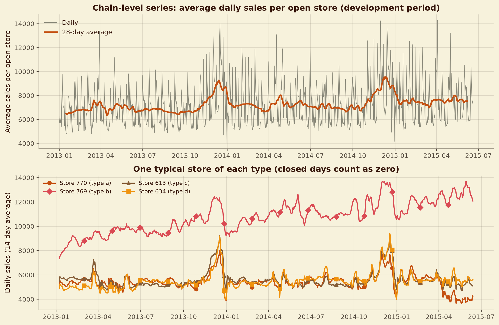

### Differencing: tried, measured, rejected

Trend-stationary means differencing is not needed, but we tested it anyway. A first difference raises the variance to 1.15 times the original, a weekly difference to 1.68; only a two-week difference lowers it, to 0.86. Then we trained the same LSTM on the two-week-differenced series: its error went from 0.083 to **0.212**. Holiday spikes dominate the differenced series, and inverting it carries every error forward every 14 days. The tests were right: model the levels.

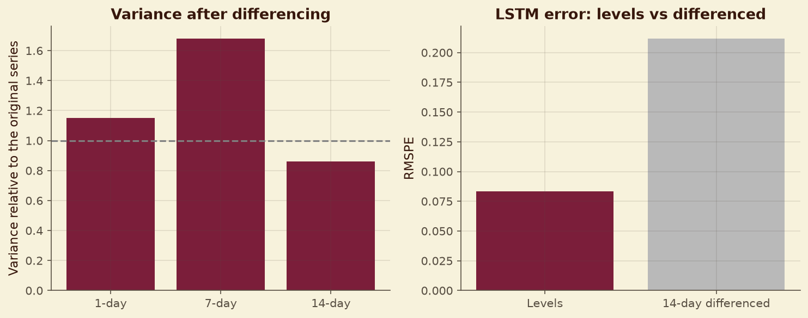

### Listening to the autocorrelation

The autocorrelation is **0.57 at lag 14** but only 0.16 at lag 7, with further peaks at 28 (0.46), 42 (0.32) and 56 (0.23). The reason is the promotion calendar: promotions run Monday to Friday in alternating weeks, so sales repeat every two weeks. That sets the LSTM's history window at **56 days, four full two-week cycles**.

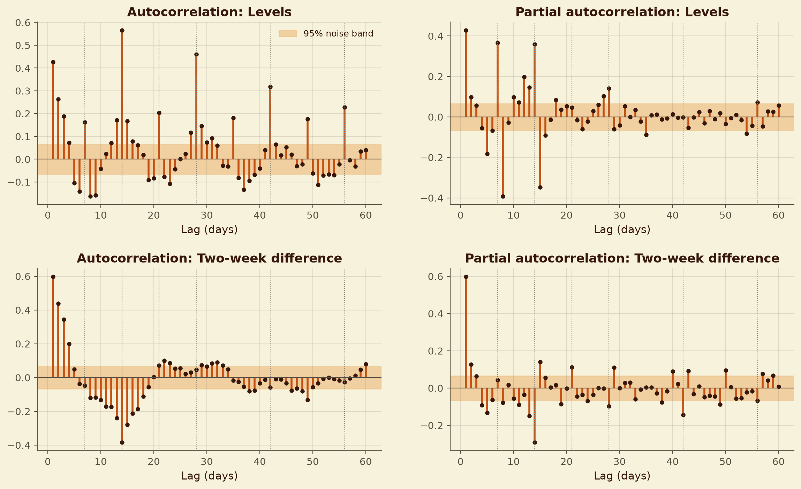

### From a series to supervised samples

Each sample is one forecast origin: 56 days of history in (scaled sales plus the planned inputs of those days), the plan for the next 48 days also given, and the 48 sales values to predict. Sales are scaled to the (-1, 1) range using the training days only. Origins are taken every 7 days, and windows are cut on demand from one compact panel (about 84 MB instead of 0.87 GB of materialised windows). Five tests (explicit slices, perturbation, scaler fitted on training days only, split structure, scaling round trip) all pass.

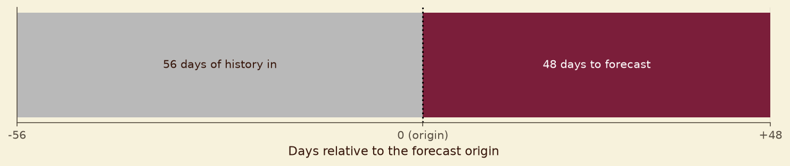

### The brief's model: next sale, then six weeks

A two-layer LSTM (64 units each, dropout 0.1, Adam) that predicts the next day's chain-level sales from the previous 56 days reaches an RMSPE of **0.083** on the rolling windows. That is the best case, because it uses the actual history up to the day before. A real six-week forecast has no yesterday, so we tried two ways of getting one. The **recursive** model feeds its own forecasts back as history for the next day: 0.084 on the rolling windows, 0.071 on the summer seasonal check. The **direct** model outputs all 48 days at once from the cut-off and reads the planned calendar of every future day: 0.083 and 0.068.

The honest answer is *no clear winner*. The gap is of the same order as the spread between random seeds, so we kept the direct design for practical reasons: one pass instead of 48, no error feedback, direct use of the known promotion calendar. The popular claim that recursion compounds its errors is not supported at chain level.

Everything else was also tested rather than assumed. Window length (28, 56, 84 days: 0.081, 0.083, 0.083) barely matters. A flat output head with 2.5 times the parameters overfits the roughly 90 training origins (0.265). And gradient boosting's store forecasts, averaged to the same series, score **0.063**: better than every LSTM variant.

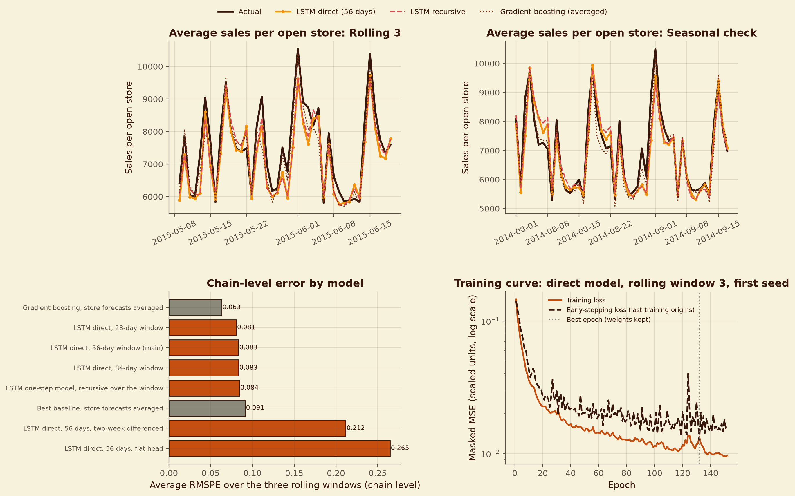

### One LSTM for 1,115 stores

A chain-level model says nothing about an individual store, so the production-scale version is a single network shared by all stores. It receives the store's 56-day history, its plan for the next 48 days, a **learned 8-number embedding of the store**, and its type, assortment and usual level. A small network applied to each future day turns the LSTM's summary and that day's plan into the forecast. It trains on about 100,000 to 114,000 store-origins per split, at most 8 epochs on two CPU cores, about 200 seconds per split.

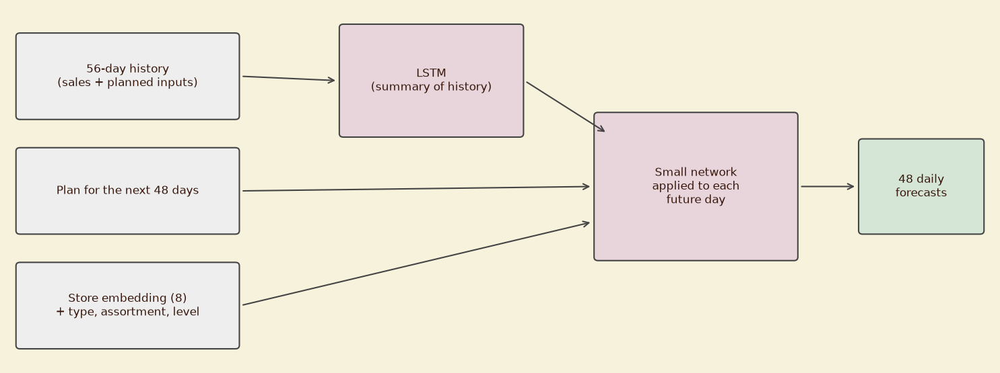

### A verdict decided in advance

Before computing the comparison we wrote a rule: a challenger replaces gradient boosting only if it (1) wins in all three rolling windows and the seasonal check, (2) has a 95% store-level bootstrap interval on the pooled rolling windows entirely below zero, and (3) gains at least 3%, because serving an LSTM adds TensorFlow and a second model to the app. The ensemble weight was fixed at 50/50 and not tuned.

On exactly the same rows, the store-level LSTM scores 0.1792, 0.1475, 0.1249, 0.1269 (rolling 1 to 3, seasonal check) against 0.1725, 0.1106, 0.1025, 0.1045 for gradient boosting. Pooled over the rolling windows that is 0.1529 against 0.1334: **14.6% higher**. The 50/50 ensemble is 2.7% higher. Both fail all three conditions, so **Gradient boosting** goes forward. The LSTM does beat the best simple rule in every window, with no hand-made history features at all.

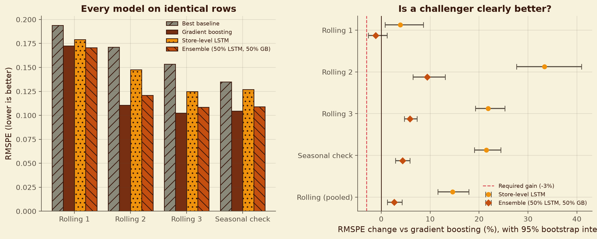

Where does the LSTM lose? Its relative standing is best in week 1 of the horizon, on Mondays (1% worse) and on promotion days (6% worse): it learned the promotion rhythm. It is weakest on Saturdays (33%), the Sundays of the few Sunday traders (91%), and non-promotion days (26%). The reason is the store-specific weekday profile, which gradient boosting receives ready-made as its most important input and which the LSTM must rediscover from 56 noisy days.

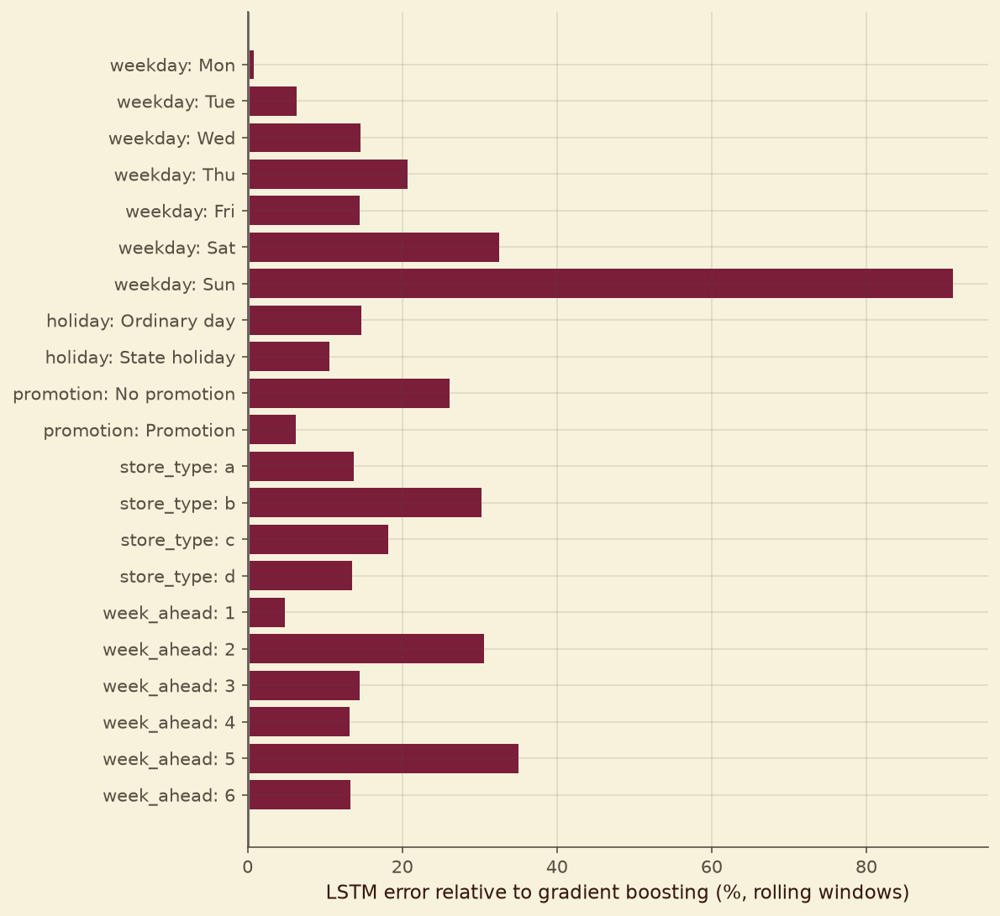

> **What the LSTM taught us**
> 1. A sequence model learns the calendar and the two-week promotion rhythm from raw data, so the engineered features are not magic.
> 2. With 2.5 years of history, the engineered per-store weekday profile still carries more information than a 56-day window can recover.
> 3. Differencing, a bigger head and longer windows each failed or made no difference. We tested them instead of assuming.
> 4. Next experiments worth running: a longer training budget on a GPU (the best epoch was the last), the weekday profile as an extra input channel, and more history.

## Part 5. How sure are we?

A single number invites false confidence, so every forecast carries a **90% prediction interval**, built from empirical residual quantiles, in the style of split-conformal calibration. On forecasts the model never trained on, we take the 5th and 95th percentiles of the log error (with the finite-sample correction) and apply them to every new forecast, separately for each forecast week and each store-size quartile. We compared it with quantile regression: narrower, but it covered only 82.8% and 84.7% on two unseen windows, while the conformal ranges covered 90.3% and 90.0%.

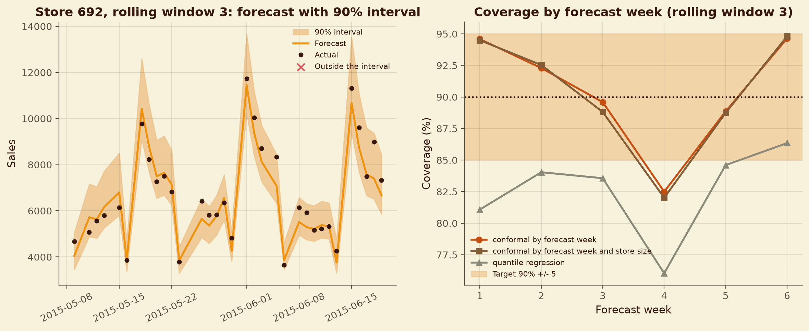

A typical range is about -13% to +20% around the forecast. On the final holdout, coverage was **88.4%**: slightly too narrow, within the 90 +/- 5 criterion we set in advance. Read the "90% range" as "about 88 to 90%". The calibration pools errors from three rolling windows, and stores share calendar shocks, so the ranges are a practical guide, not an exact guarantee. On the holdout, actual sales fell below the lower end more often (about 8%) than above the upper end (about 3.5%), so treat the lower end as the optimistic side.

## Part 6. The final exam

After every choice was frozen, the frozen configuration, trained on the development period only, was scored on the holdout (20 June to 31 July 2015) in the final run. Its RMSPE is **0.1068**, against 0.1468 for the best simple rule. The target (at most 0.13 and below the baseline) is **met**. The customer model scores 0.0877. The model beats the rule in every weekday, every forecast week and every store type, and about 71% of store-days are forecast within 10% of the actual value.

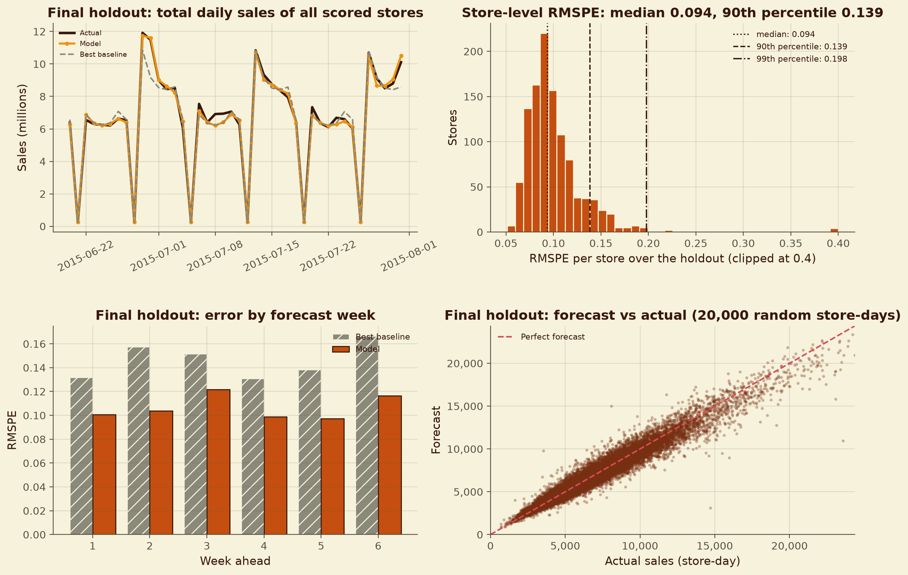

The weak spots are honest ones: Saturdays (0.127), the Sundays of the few Sunday traders (0.158), and stores within 60 days of reopening after a long closure (0.175). A handful of stores dominate the tail, and five of the ten worst are among the 180 with the missing 2014 history. Week 5 (0.097) was as good as week 1 (0.101), plausibly because the promotion and holiday calendar of every forecast day is known in advance.

## Part 7. From notebook to product

**Versioned, tracked, timestamped.** Four data versions are tagged in git and stored with DVC (raw, cleaned, features, final). Every baseline, tuned model and LSTM run, each seed included, is logged in MLflow, and 5 models are registered. The production bundle is saved with a timestamp in the filename (`models/15-11-2026-21-07-42.pkl`, 4.2 MB), so any forecast can be traced to the model that made it.

> **A bug worth knowing about.** Our first attempt to serve the model through MLflow differed from the trained model by up to 417 sales units on more than half the rows. MLflow converts 8- and 16-bit integer columns to 32-bit, which moves the preprocessing from float32 to float64 arithmetic and flips a few tree splits. A small wrapper restores the training column types. Serving a model is not the same as saving it, and the only way to know is to compare predictions. Ours now forecast all 41,088 test rows with a difference of 0.000000 sales units.

**The app.** A manager picks a store, uploads the plan for the coming days (promotions, holidays, opening days) and gets daily sales and customer forecasts with 90% ranges, a chart and a CSV download. Seven kinds of bad input are rejected with a plain message saying what to fix. It builds its inputs with the same code as the training pipeline, and for all 856 test stores its forecasts equal the submission file. One store takes 0.37 seconds, so it fits a free hosting tier. Try it: https://rossmann-forecast-nexthikes.streamlit.app/

## Next steps, and what this cannot tell you

**Use it like this.** Plan on the forecast and its 90% range, not on a single number, and re-run it when promotions change. Test changes to promotion spend first where the observed response is weakest (type b, extra assortment, Fridays). Give extra attention to state holidays, the 33 Sunday-trading stores, reopened stores, and the three competitors opening inside the test window.

**Limits.** Promotion and competitor results are associations from one shared calendar. There are only two and a half years of history, one full earlier summer, and the 2014 gap. The LSTM trained on a CPU budget of at most 8 epochs, so the honest conclusion is "not better under this budget and this history", not "LSTMs cannot do this".

**Next.** Give the LSTM the weekday profile as an input channel and a GPU budget, then repeat the same fair comparison with the same decision rule. Add a controlled promotion experiment with costs and margins. Monitor live forecast error by store and week.

## References

Hochreiter, S. and Schmidhuber, J. (1997). Long short-term memory. *Neural Computation*, 9(8), 1735-1780. | Friedman, J. H. (2001). Greedy function approximation: a gradient boosting machine. *Annals of Statistics*, 29(5), 1189-1232. | Pedregosa, F. et al. (2011). Scikit-learn: machine learning in Python. *JMLR*, 12, 2825-2830. | Lundberg, S. M. and Lee, S.-I. (2017). A unified approach to interpreting model predictions. *NeurIPS*, 30. | Lei, J. et al. (2018). Distribution-free predictive inference for regression. *JASA*, 113(523), 1094-1111. | Dickey, D. A. and Fuller, W. A. (1979). *JASA*, 74(366), 427-431. | Kwiatkowski, D. et al. (1992). *Journal of Econometrics*, 54, 159-178. | Zaharia, M. et al. (2018). Accelerating the machine learning lifecycle with MLflow. *IEEE Data Engineering Bulletin*, 41(4), 39-45.

## References and tools

**Data.** Rossmann Store Sales competition data (train.csv, test.csv, store.csv), Kaggle.

## References and tools

**Tools.** Python 3.14.3, pandas, NumPy, scikit-learn 1.9.0, TensorFlow 2.22.0rc0 and Keras 3.15.1 (LSTM), statsmodels, SHAP, MLflow 3.16.1, DVC 3.67.1, Streamlit 1.65.0, Git and GitHub.

**Methods and background.**
- Hyndman, R. J. and Athanasopoulos, G., *Forecasting: Principles and Practice* (time-series diagnostics, decomposition, accuracy measures).
- Hochreiter, S. and Schmidhuber, J. (1997), Long Short-Term Memory, *Neural Computation* 9(8).
- Lundberg, S. M. and Lee, S.-I. (2017), A Unified Approach to Interpreting Model Predictions, *NeurIPS* (SHAP).
- Vovk, V., Gammerman, A. and Shafer, G. (2005), *Algorithmic Learning in a Random World* (conformal prediction).
